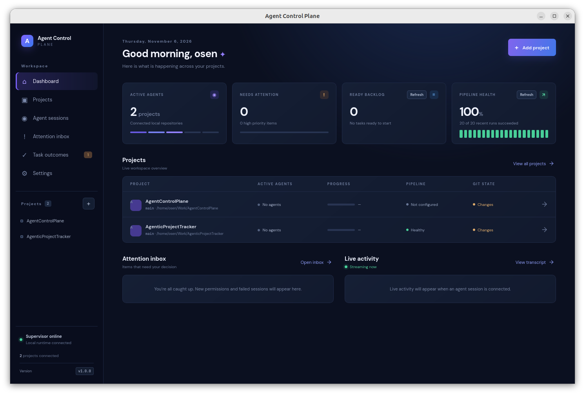
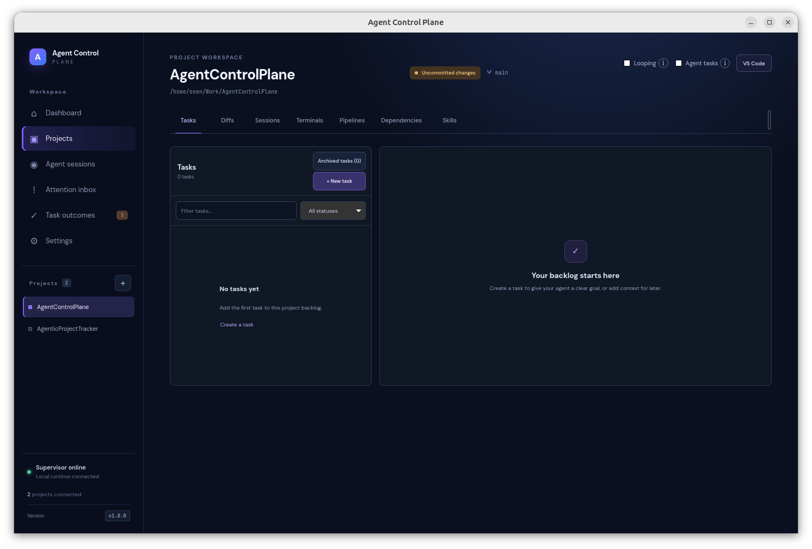
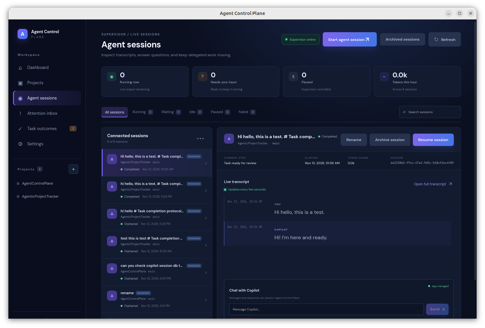
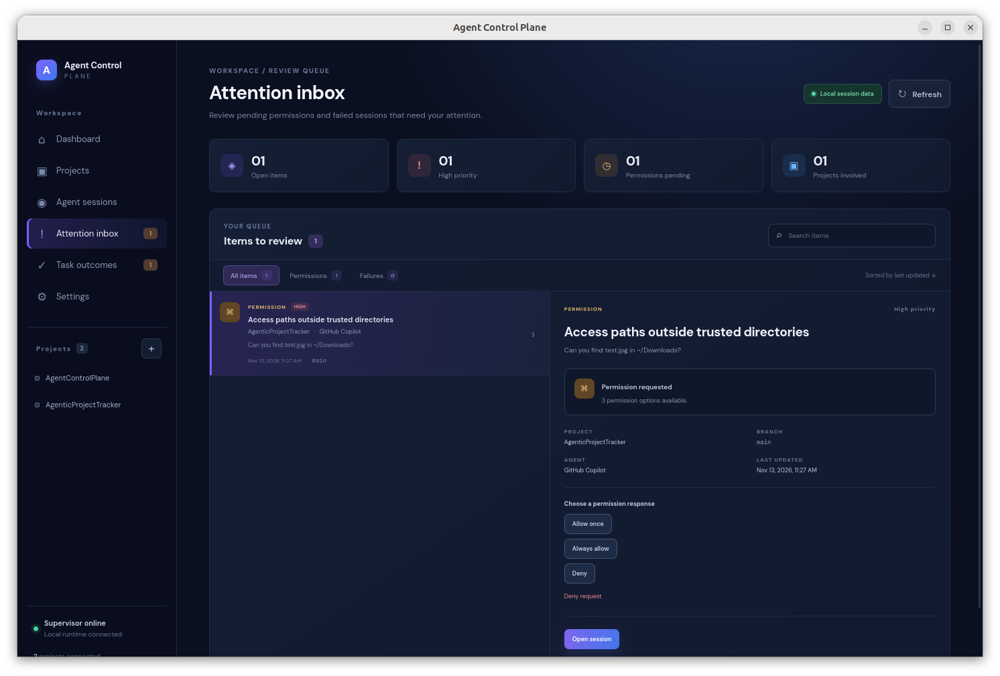
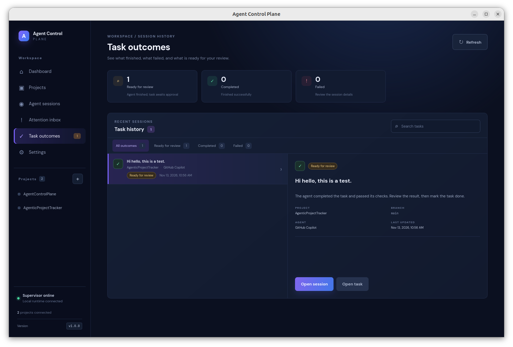
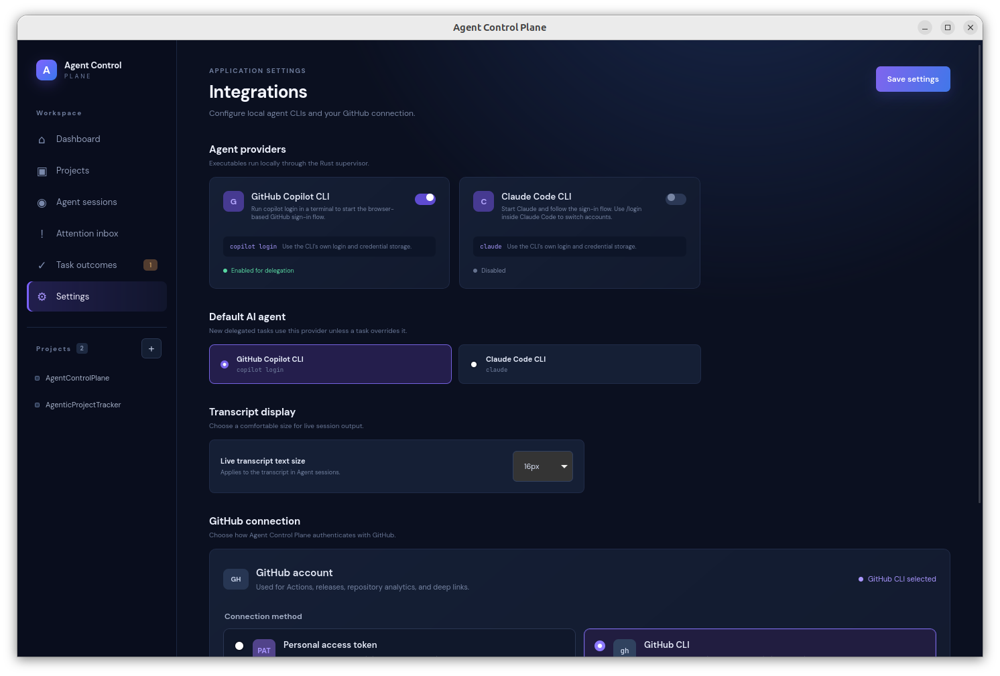

# Agent Control Plane

**A local-first command center for supervising AI coding agents across projects.**

Bring your repositories, agent sessions, and delegated work together in one
desktop workspace. Keep an eye on what agents are doing, respond when they need
your input, and review outcomes without losing sight of the projects they work
in.

## Features

- **One workspace for multiple projects** — see project activity, Git state,
  agent sessions, and pipeline health from the dashboard.
- **Task-based delegation** — organize project backlogs and give agents clear
  work to pick up.
- **Live session supervision** — follow streaming transcripts, inspect session
  state, and resume conversations.
- **Human-in-the-loop controls** — review permission requests and failed
  sessions in the attention inbox, then choose how to proceed.
- **Outcome review** — see completed, failed, and review-ready work and inspect
  results before marking tasks done.
- **Project tools in context** — browse diffs, terminals, pipelines,
  dependencies, and skills alongside each project.
- **Copilot and Claude Code support** — enable local CLI providers and select a
  default in Settings.
- **Local-first session data** — session lists and transcripts are stored in
  the app's own SQLite database. Copilot uses its supported Agent Client
  Protocol; Claude Code runs through its local headless CLI with structured
  stream output. The app does not open either CLI's private session stores.

## Agent CLI setup

Install GitHub Copilot CLI separately before enabling it in Settings. The
desktop app searches `PATH`, common per-user install locations such as
`~/.local/bin`, and standard Homebrew locations. For a custom install location,
set `COPILOT_CLI_PATH` to the executable path.

## Screenshots

<p align="center">
  
</p>
<p align="center"><sub>Get a quick overview of projects, agent activity, and work that needs attention.</sub></p>

<table>
  <tr>
    <td width="50%">
      
      <p align="center"><sub>Manage project backlogs and open project tools.</sub></p>
    </td>
    <td width="50%">
      
      <p align="center"><sub>Follow transcripts and manage agent sessions.</sub></p>
    </td>
  </tr>
  <tr>
    <td width="50%">
      
      <p align="center"><sub>Review permission requests and other items needing a decision.</sub></p>
    </td>
    <td width="50%">
      
      <p align="center"><sub>Inspect completed work and review-ready outcomes.</sub></p>
    </td>
  </tr>
  <tr>
    <td colspan="2">
      
      <p align="center"><sub>Choose agent providers and configure integrations.</sub></p>
    </td>
  </tr>
</table>

## Development

```bash
npm install
npm run dev
```

To run the desktop shell:

```bash
npm run tauri dev
```

The desktop build requires the Rust toolchain and the platform prerequisites
listed in the [Tauri guide](https://tauri.app/start/prerequisites/). On Debian
or Ubuntu, install the WebKit, GTK, DBus, OpenSSL, X11, AppIndicator, and
librsvg development packages before running `npm run tauri build`.

## Validation

```bash
npm run build
npm run tauri build
```

The web build is currently independent of native system libraries; the Tauri
build validates the complete desktop bundle.

## Releases

Pushing a Git tag matching `v*` builds the desktop app for Linux, macOS, and
Windows and publishes the installers as a GitHub Release. Use a semantic
version tag such as `v1.2.3`; the tag version is applied to the app and its
package metadata before building.
